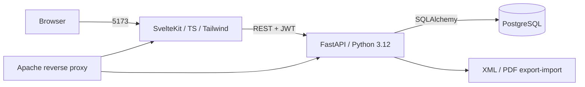

# ExperiLearn — Experiential Learning & Technology Platform

An EdTech SaaS platform: students learn via virtual labs, simulations, case studies, DIY projects, video lessons and quizzes; instructors create courses and see analytics; admins manage users and legacy migration.

**Live demo:** https://experilearn.64-181-219-26.sslip.io — seeded with the demo accounts below.

## Architecture



## Tech stack

SvelteKit · TypeScript · Tailwind · FastAPI · SQLAlchemy · Pydantic v2 · PostgreSQL · JWT + bcrypt · Docker · GitHub Actions

## Setup

```bash
docker compose up --build   # all three services, one command
# frontend http://localhost:5173 · backend http://localhost:8000 · docs http://localhost:8000/docs
```

Without Docker: backend `cd backend && pip install -r requirements.txt && uvicorn app:app --reload` (uses SQLite locally if `DATABASE_URL` unset); frontend `cd frontend && npm i && npm run dev`.

## API docs

http://localhost:8000/docs (OpenAPI) · health check http://localhost:8000/health

## Demo credentials (seeded on startup)

| Role | Email | Password |
|---|---|---|
| Admin | admin@experilearn.com | Admin@123 |
| Instructor | instructor@experilearn.com | Instructor@123 |
| Student | student@experilearn.com | Student@123 |

Seed: 3 demo users, 10 realistic courses, 40 modules (30+), quizzes per course.

## Screens

- Home — value proposition and entry points.
- Login / Register — role-aware redirects (student → My Learning, instructor → Instructor, admin → Admin).
- Catalog — search, category and difficulty filters, pagination.
- Course detail — module list, enroll, progress bar.
- Learning player — module content, mark complete (certificate at 100%).
- Quiz player — 5-minute timer, auto-grading, pass ≥ 80%.
- Instructor — stats, enrollments per course, create course/module.
- Admin — platform stats, user list, XML course import.

## Deploy (Oracle Cloud free VM)

The demo runs on an Oracle Linux ARM VM: backend as a systemd service on `127.0.0.1:8000`, static SvelteKit build served by Caddy, API proxied under `/api`. Deployment files are in `deploy/`.

```bash
# on the server
python3.12 -m venv /opt/experilearn/backend/.venv
/opt/experilearn/backend/.venv/bin/pip install -r /opt/experilearn/backend/requirements.txt
sudo cp deploy/experilearn.service /etc/systemd/system/ && sudo systemctl enable --now experilearn
# frontend: build with VITE_API=/api, copy build/ to /var/www/experilearn, then reload Caddy
```

Caddy handles HTTPS automatically (see `deploy/experilearn.caddy`). For serverless instead, the static build also works on Cloudflare Pages/Vercel; the API needs a Python host (Render/Railway/Fly/Modal) and PostgreSQL.

## Tests

```bash
cd backend && python -m pytest tests -q   # auth + courses, all pass
```

CI runs backend pytest and frontend build on push/PR.
